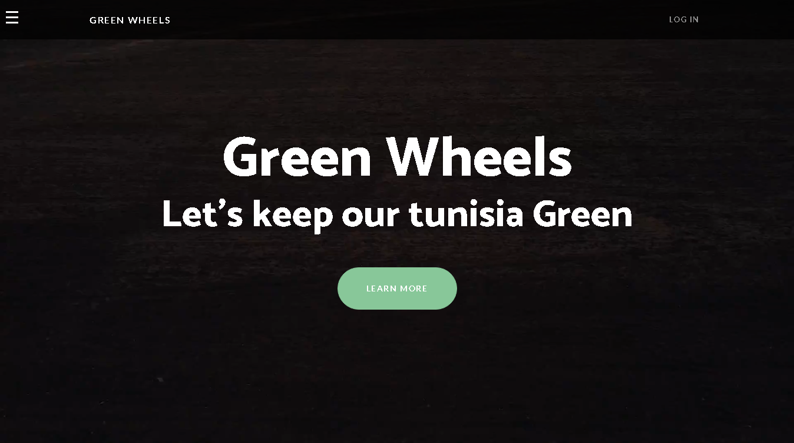
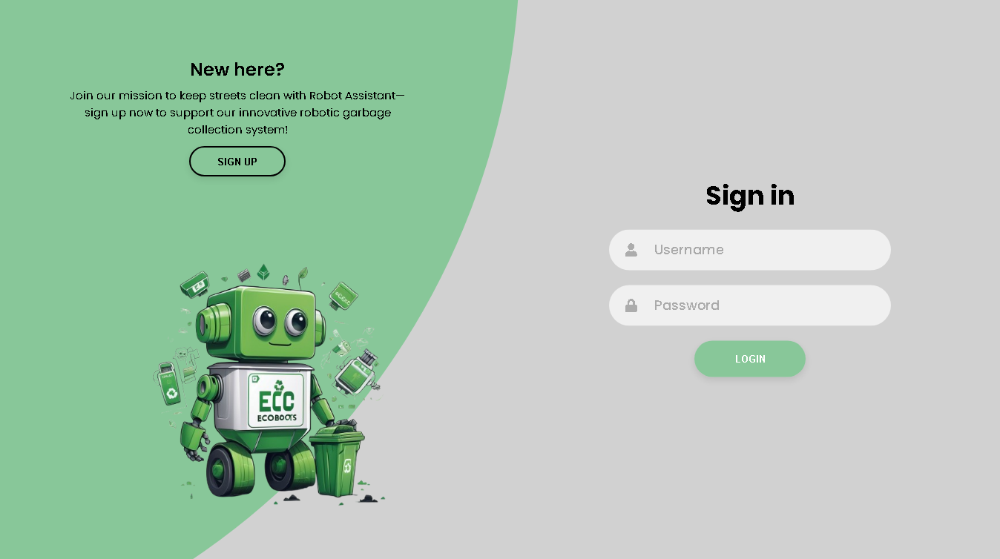
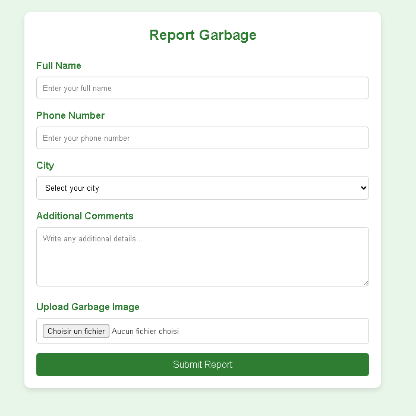
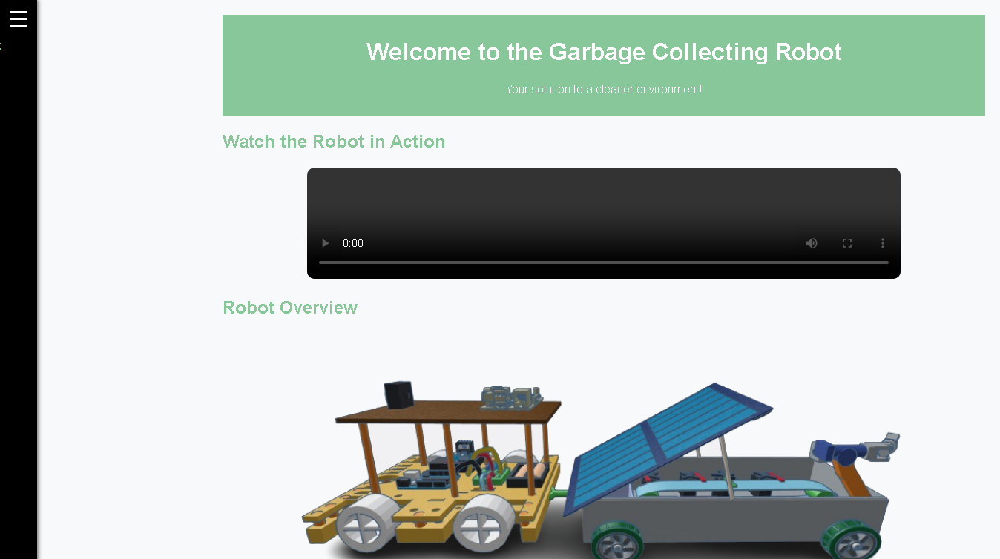

# Green Wheels

**Let's keep our Tunisia green.** Green Wheels is the website of a solar powered garbage collecting robot. Citizens can create an account, report garbage with a photo, follow the robot on a map of Tunisia and learn how the robot works. An admin dashboard lists the requests.

Frontend in **HTML, CSS and JavaScript (Bootstrap)**, backend in **Node.js and Express** with a **MySQL** database for the user accounts.



## Features

| Page | File | What it does |
|---|---|---|
| Home | `frontend/home.html` | Landing page with a side menu and links to every section |
| Sign in and sign up | `frontend/login.html` | Account creation (username, email, password, gender, date of birth, city) and login, checked by the Express API |
| Report garbage | `frontend/report.html` | Form with name, phone, city, comments and a photo of the garbage |
| Find your robot | `frontend/map.html` | Shows the robot position on Google Maps inside Tunisia (simulated) |
| Robot road | `frontend/road.html` | Draws a road line on an OpenStreetMap map of Tunisia |
| About the robot | `frontend/aboutrobot.html` | Video, 3D overview, mobility system, garbage collecting system and how to use the robot |
| Admin dashboard | `frontend/adminrquest.html` | Requests management for the administrator |
| Contact | `frontend/contact.html` | Contact form |

## Screenshots

| Sign in | Report garbage |
|:---:|:---:|
|  |  |



## Architecture

| Part | Technology | Role |
|---|---|---|
| Frontend | HTML, CSS, JavaScript, Bootstrap 5 | Pages of the website |
| Backend | Node.js, Express, body parser, CORS | REST API on port 3000 |
| Database | MySQL (`mysql2`) | Table `users` |
| Config | dotenv | Database settings read from `.env` |

**API**

| Method | Route | Body | Result |
|---|---|---|---|
| POST | `/login` | `username`, `password` | Success or error message |
| POST | `/signup` | `username`, `email`, `password`, `gender`, `dob`, `city` | Creates the account, refuses a duplicate username |

## Project structure

```
Greenwheels/
|  package.json
|  .env.example            Database settings template
|__ backend/
|   |  server.js           Express API and MySQL connection
|   |  login.js            Login and signup requests from the browser
|   |  map.js, road.js     Map pages logic
|   |  home.js, contact.js, sidebar-toggle.js
|__ frontend/              HTML and CSS of every page
|__ database/
|   |  schema.sql          Creates the database and the users table
|__ img/                   Images and video of the website
|__ docs/                  Screenshots
```

## Quick start

```bash
git clone https://github.com/achrefslim/Greenwheels.git
cd Greenwheels
npm install
mysql -u root -p < database/schema.sql
```

Copy `.env.example` to `.env`, put your MySQL password in it, then:

```bash
npm start
```

Open `frontend/login.html` in your browser. Full steps in [TUTORIAL.md](TUTORIAL.md).

## Possible improvements

1. Hash the passwords (for example with bcrypt) instead of storing them in clear text
2. Save the garbage reports in the database and show them in the admin dashboard
3. Serve the frontend from Express so the whole site runs from one address
4. Connect the map to the real GPS position of the robot

## Author

[achrefslim](https://github.com/achrefslim)
